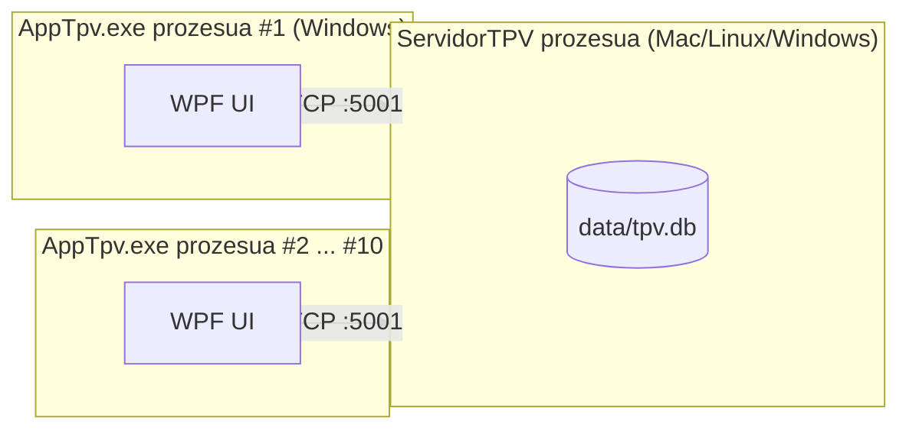
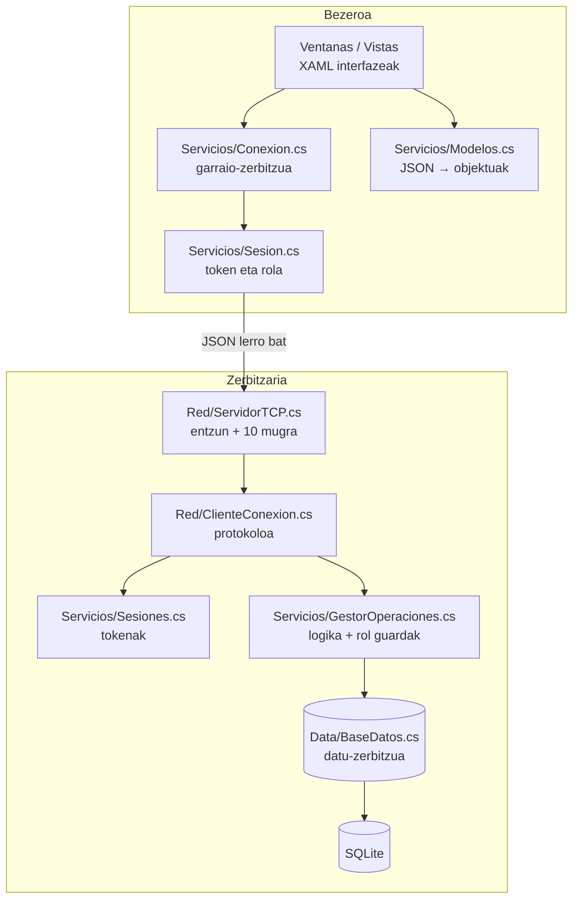
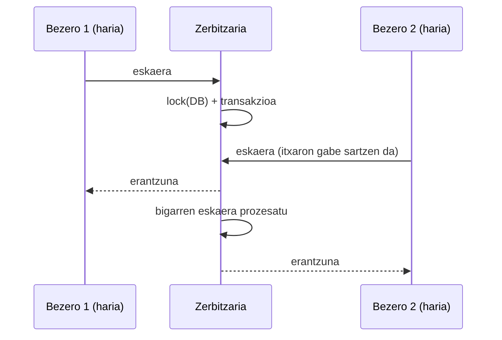
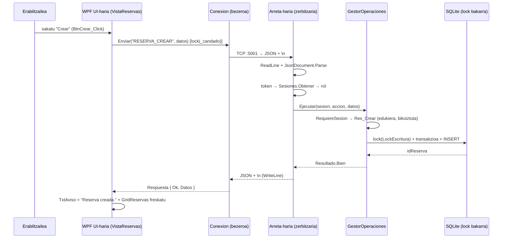

# Aurkezpena: zerbitzuak, prozesuak, hariak eta socketak

Erronkaren 3. baldintza: *bezero-zerbitzari arkitektura, TCP konexioa, gehienez
10 erabiltzaile aldi berean, eta bezero bakoitzari zerbitzua emateko hari
independentea*. Hona hemen zati hau defentsan azaltzeko materiala.

---

## 1. Oinarrizko kontzeptuak

| Kontzeptua | Zer da? | AppTpv-n |
|---|---|---|
| **Prozesua** | Exekutatzen ari den programa bat; bere memoria-espazioa du. | `ServidorTPV` (konsola) eta bezero bakoitzeko `AppTpv.exe` (WPF). |
| **Haria (thread)** | Prozesu barruko exekuzio-fluxua; prozesu bereko memoria partekatzen dute. | Zerbitzariaren entzule-haria, bezero bakoitzeko arreta-haria, WPF-ren UI-haria. |
| **Socket-a** | Bi prozesuren arteko komunikazio-amaiera (endpoint): **IP + ataka**. TCP-n, byte-fluxu fidela. | Zerbitzaria `0.0.0.0:5001`-en entzuten; bezeroa `IP:5001`-era konektatzen da. |
| **Zerbitzua** | Erantzukizun jakin bat duen eta besteek erabiltzen duten logika-geruza. | `ServidorTCP`, `Sesiones`, `GestorOperaciones`, `BaseDatos`, bezeroaren `Conexion`... |

Analogia: **prozesua** jatetxea da, **hariak** langileak, **socket-a** telefono-lerroa,
eta **zerbitzuak** sukaldea, kutxa eta erreserben mahaiak: bakoitzak lan bat du
eta besteek hari deitzen diote.

---

## 2. Prozesuak



- Zerbitzari-prozesu **bakarrak** dauka datu-basea. Bezeroek ez dute DB fitxategia
  irakurtzen: eskaerak bidaltzen dituzte eta zerbitzariak erantzuten du.
- Bezero bakoitzak **prozesu independientea** da. Batek huts eginez gero,
  besteek normal jarraitzen dute.
- Zerbitzaria `ServidorTPV/Program.cs`-en hasten da:

```csharp
BaseDatos.Inicializar();                                  // DB sortu/haziak
var servidor = new Thread(ServidorTCP.Instancia.Arrancar) { IsBackground = true };
servidor.Start();                                         // entzuteko harixa
while (true) { if (Console.ReadLine() == "parar") ... }   // prozesua bizirik mantendu
```

- `IsBackground = true`: prozesua itxi daiteke hari horiek amaitu gabe.
- Amaitzeko: `parar` + Enter edo `Ctrl+C`. Bezeroak `LOGOUT` bidaltzen du
  `App.xaml.cs`-eko `App_Exit`-en, bere lekua askatzeko.

**Zergatik banatu prozesuetan?** Datuak zentralizatzeko, baimenak leku bakarrean
egiaztatzeko (`admin` vs `usuario`) eta hainbat makina aldi berean konektatzeko.

---

## 3. Zerbitzuak (geruzak)



| Zerbitzua | Fitxategia | Zer egiten du |
|---|---|---|
| Entzuketa | `Red/ServidorTCP.cs` | Socket-a ireki, 10 bezero onartu, hari bat sortu bakoitzerako |
| Protokoloa | `Red/ClienteConexion.cs` | Lerroa irakurri, JSON parsedu, `accion` eta `token` atera, erantzuna idatzi |
| Saioak | `Servicios/Sesiones.cs` | Token GUID → erabiltzailea/rola; `ConcurrentDictionary` |
| Negozioa | `Servicios/GestorOperaciones.cs` | 20 ekintza, `RequiereAdmin` / `RequiereSesion`, transakzioak |
| Datuak | `Data/BaseDatos.cs` | SQLite konexioa, eskema, haziak, `LockEscritura` |
| Segurtasuna | `Data/Seguridad.cs` | SHA-256 + gatz finkoa |
| Garraioa (bezeroa) | `Servicios/Conexion.cs` | `TcpClient`, bidali/jaso, konexioa berriro ireki |
| Saioa (bezeroa) | `Servicios/Sesion.cs` | Token, login, rola lokalean |

**Abantaila defentsan:** geruzak bereizita daudenez, rol-egiaztapena zerbitzarian
bakarrik dago; bezeroak pestañak ezkutatzea aurkezpena baino ez da.

---

## 4. Hariak

### Zein hari daude?

| Haria | Non sortzen da | Zer egiten du |
|---|---|---|
| Zerbitzariaren hari nagusia | `Program.cs` | DB hasieratu, entzule-haria abiarazi, kontsolaren `parar` irakurri |
| Entzule-haria | `Program.cs` → `ServidorTCP.Arrancar()` | `AcceptTcpClient()` etengabe; bezero berri bakoitzeko hari bat sortu |
| Arreta-haria ×N | `ServidorTCP.cs` → `ClienteConexion.Atender()` | Bebero baten mezuak irakurri eta erantzun (blokeatzailea) |
| WPF UI-haria | Bezeroaren prozesua | XAML kontrolak, klik-gertaerak, `TxtAviso`, `Grid...` eguneraketak |

### Zergatik hari bat bezero bakoitzeko?

`ClienteConexion.Atender()`-ek `lector.ReadLine()` egiten du: **blokeatzen da**
bezeroak zerbait bidali arte. Hari bakarra balitz, bezero batek denbora luzea
hartuko balu (edo konexioa mantenduz ezer bidali ez), gainerako 9ak itxaron
egingo lukete. Hari independente batekin, **bakoitza bere erritmoan** doa.



### sinkronizazio-mekanismoak

| Mekanismoa | Non | Zergatik |
|---|---|---|
| `Interlocked.Increment/Decrement(ref _clientes)` | `ServidorTCP.cs` | Hainbat hari aldi berean kontadorea aldatzen ari dira; `++` ez da atomikoa |
| `ConcurrentDictionary` | `Sesiones.cs` | Tokenak hari desberdinetatik gehitu/ezabatu/kontsultatzen dira |
| `lock (BaseDatos.LockEscritura)` | `BaseDatos.cs` | DB idazketak serializatu; erronkak berak baimentzen du lock bakarra |
| `lock (_candado)` | `Conexion.cs` (bezeroa) | Bi gertaerk aldi berean bidali ez ditzaten socket berean |
| `IsBackground = true` | hari guztiak | Prozesua itxi ahal izateko |

**Ohartarazpen zintzoa:** bezeroaren `Conexion.Enviar()` sinkronoa da (erantzuna
itxaroten du), baina tokiko sarerako milisegundo batzuk baino ez dira; hala ere,
`BtnEnviar`-eko `IsEnabled = false` botoiarekin bikoizketak saihesten dira.
Erantzukizun nagusia zerbitzariaren aldeko hari independentea da: bezero batek
ez ditu besteak blokeatzen.

---

## 5. Socketak

### Zer da socket bat?

IP helbide baten eta ataka baten konbinazioa: `192.168.64.1:5001`.
TCP protokoloak **byte-fluxu fidela** eskaintzen du: ordena mantentzen da eta
paketeak ez dira galtzen, baina **ez du mezuen mugarik** — horregatik erabiltzen
du aplikazioak *framing*: **JSON lerro bat = mezu bat**, `\n`-rekin amaituta.

### Zerbitzariaren socketaren bizitza

```csharp
var ouvinte = new TcpListener(IPAddress.Any, 5001);  // 1. ireki
ouvinte.Start();                                      // 2. entzun
var cliente = ouvinte.AcceptTcpClient();               // 3. onartu (blokeatzailea)
var flujo = cliente.GetStream();                      // 4. byte-fluxua
var lector = new StreamReader(flujo, Encoding.UTF8);  // 5. irakurri
var escritor = new StreamWriter(flujo, ...) { AutoFlush = true };
while ((linea = lector.ReadLine()) != null) { ... }   // 6. mezuak
// 7. using blokeek socket-a itxi egiten dute
```

### Bezeroaren socketaren bizitza

```csharp
_cliente = new TcpClient();
_cliente.ConnectAsync(Host, Puerto).Wait(5000);       // 5 s-ko timeout-a
var flujo = _cliente.GetStream();
_escritor = new StreamWriter(flujo, new UTF8Encoding(false)) { AutoFlush = true };
_lector = new StreamReader(flujo, Encoding.UTF8);
```

### Mezuaren formatua

```json
{"accion":"RESERVA_CREAR","token":"a1b2...","datos":{"idMesa":1,"turno":"bazkaria"}}
```

Erantzuna:

```json
{"ok":true,"datos":{"idReserva":7,"mensaje":"Reserva creada"}}
```

### 10 bezeroen muga

`AcceptTcpClient()` ondoren `Interlocked.Increment` egiten da. 10 baino gehiago
badira, 11.ari honako hau bidali eta socket-a berehala itxi egiten zaio:

```json
{"ok":false,"error":"SESSION_LIMIT","datos":"Servicio lleno (10/10). Reintentelo mas tarde"}
```

### Sarea VM-an

- Zerbitzaria bezero bereko prozesuan badago: `127.0.0.1:5001`.
- Windows VM batean badago: ostalariaren IPa, adibidez `192.168.64.1:5001`.
- Bezeroak `servidor.txt` fitxategia irakurtzen du exe-ren ondoan; lehen
  lerroa `IP:ATAKA`. Ez badago, lehenespenez `127.0.0.1:5001`.

### Konexioa galtzen denean

`Conexion.Enviar()`-ek `SocketException` / `IOException` harrapatu, `Cerrar()`
deitu eta `No se pudo conectar al servidor IP:ATAKA` mezua itzultzen du.
Hurrengo eskaeran `AsegurarConexion()` berriro konektatzen saiatzen da.

---

## 6. Eskaera baten bizitza (adibidea: erreserba sortzea)



---

## 7. Defentsarako gidoia (1–2 minutu)

> "Sistema bi **prozesutan** banatuta dago: alde batetik zerbitzaria, SQLite
> datu-basea duena, eta bestetik bezero bakoitza, WPF interfazea erakusten duena.
> Bi prozesuek ez dute memoria partekatzen; **socket** baten bidez hitz egiten
> dute, TCP protokoloarekin, 5001 atakan. Mezu bakoitza JSON lerro bat da,
> `\n`-rekin bukatuta; horrela framing-a sinplea da.
>
> Zerbitzariak hiru **hari** mota ditu: nagusia kontsola kudeatzeko, entzulea
> `AcceptTcpClient`-ekin, eta bezero bakoitzeko arreta-hari bat. Azken hau
> garrantzitsua da: `ReadLine` blokeatzen da, eta hari bakarra izango bagenu,
> bezero batek beste guztiak blokeatuko lituzke. Hari bana izanda, 10 bezero
> aldi berean egon daitezke eta interfazeek normal funcionatzen dute.
>
> Kontadorea `Interlocked`-ekin eguneratzen da, saioak `ConcurrentDictionary`
> batean daude, eta datu-baseko idazketa guztiak **lock bakar** baten barruan
> egiten dira, enunciatuak berak onartzen duena; irakurketak WAL moduan paraleloan
> doaz.
>
> Logika geruzatan dago: `ServidorTCP` socket-ez arduratzen da,
> `ClienteConexion` protokoloaz, `Sesiones` tokenaz, `GestorOperaciones`
> negozioaz eta rol-egiaztapenez, eta `BaseDatos` datuaz. Hori dela eta,
> erabiltzaile arrunt batek ezin du admin-ekintzarik egin, nahiz eta bezeroan
> pestañak ezkutatuta egon."

---

## 8. Galderak eta erantzunak

| Galdera | Erantzuna |
|---|---|
| Zergatik TCP eta ez HTTP? | Erronkak TCP eskatzen du; framing sinplea (JSON + lerroa) eta konexio iraunkorra nahikoa da tokiko sarerako. |
| Zer gertatzen da 11. bezeroarekin? | `SESSION_LIMIT` errorea jaso eta socket-a itxi egiten zaio; gainerakoek jarraitzen dute. |
| Zer da token-a? | LOGIN ondoren zerbitzariak emandako GUID bat. Mezu guztiekin bidaltzen da; hura gabe ezin da ekintzarik egin. |
| Zergatik `Interlocked` eta ez `i++`? | `i++` ez da atomikoa; bi hariek aldi berean irakurri eta idatziz gero kontadorea okerra izan daiteke. |
| Zergatik lock bakarra DBan? | Idazketak serializatzen ditu, bi erabiltzailek taula berean aldi berean idaztea saihesteko. Enunciatuak baimentzen du; lock gutxiago → deadlock arrisku gutxiago. |
| Irakurketak ere blokeatzen dira? | Ez. SQLite WAL moduan dago; irakurketak lock gabe egin daitezke. |
| Zergatik hari bat bezero bakoitzeko? | `ReadLine` blokeatzen delako; bestela bezero geldo batek gainerakoak itxararaziko lituzke. |
| Zer da IP:ataka bikotea? | Socket baten helbidea. Zerbitzaria `0.0.0.0:5001`-en dago; bezeroak ostalariaren IPa erabiltzen du VM-an. |
| Nola saihesten da interfazearen blokeoa? | Zerbitzarian hari independente batekin; bezeroan deiak laburrak dira eta botoiak desgaitu egiten dira bikoizketak ekiditeko. |
| Nola amaitzen da konexioa? | `LOGOUT` mezua (saioa mapatik kentzen du), `App_Exit`, edo errorea gertuz gero `Cerrar()`. |

---

## 9. Kodean non aurkitu

| Kontzeptua | Fitxategia / lerroak |
|---|---|
| DB hasieratu + hari nagusiaren hasiera | `ServidorTPV/Program.cs` 11–19 |
| Ataka eta 10 bezeroen konstanteak | `ServidorTPV/Red/ServidorTCP.cs` 15–16 |
| `AcceptTcpClient` + `Interlocked` + `SESSION_LIMIT` | `ServidorTPV/Red/ServidorTCP.cs` 32–45 |
| Bezero bakoitzeko harixa | `ServidorTPV/Red/ServidorTCP.cs` 49–59 |
| Socket-a, `ReadLine`/`WriteLine`, JSON parse | `ServidorTPV/Red/ClienteConexion.cs` 18–60 |
| `LOGOUT` zuzenean kudeatuta | `ServidorTPV/Red/ClienteConexion.cs` 52–56 |
| Saioen mapa konkurrentea | `ServidorTPV/Servicios/Sesiones.cs` 17–34 |
| Rol guardak | `ServidorTPV/Servicios/GestorOperaciones.cs` 78–89 |
| Idazketa-lock bakarra | `ServidorTPV/Data/BaseDatos.cs` 22, `GestorOperaciones.cs` 855–863 |
| Bezeroaren socket-a + timeout + lock | `ClienteWPF/Servicios/Conexion.cs` 37, 59–124 |
| UI-haria / saioa ixtea | `ClienteWPF/App.xaml.cs` 13–25 |
