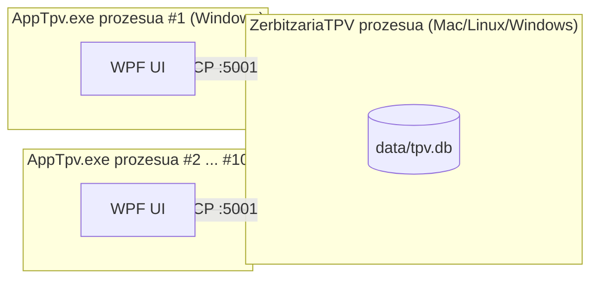
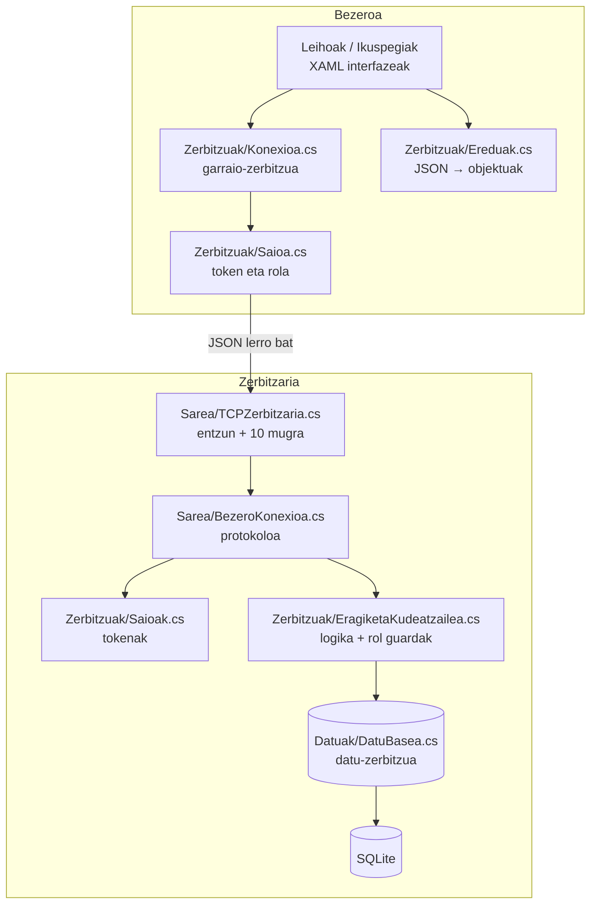
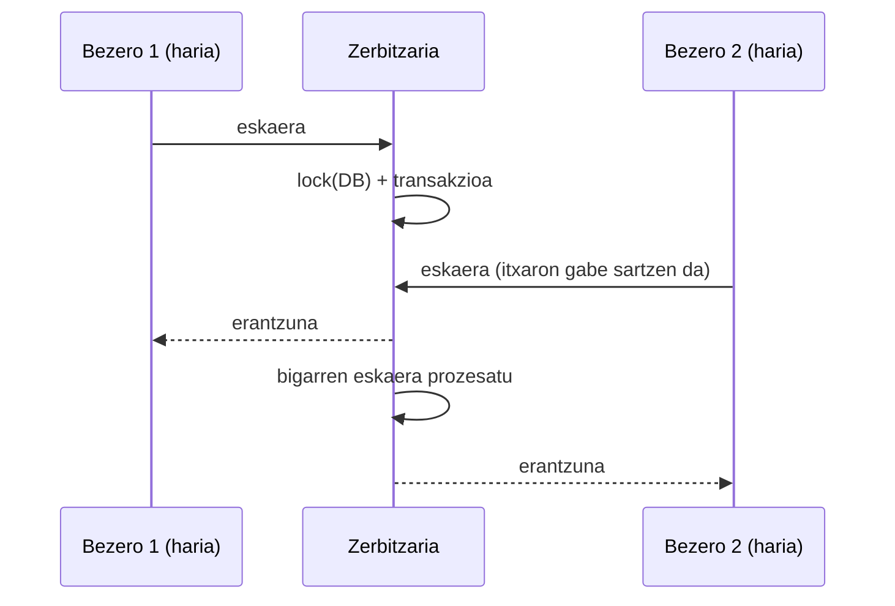
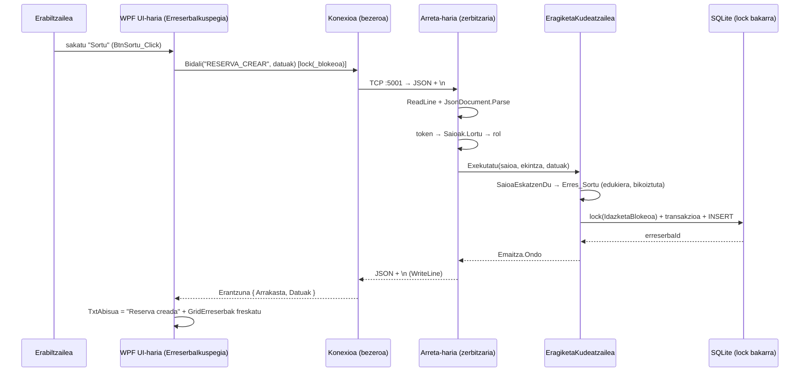

# Aurkezpena: zerbitzuak, prozesuak, hariak eta socketak

Erronkaren 3. baldintza: *bezero-zerbitzari arkitektura, TCP konexioa, gehienez
10 erabiltzaile aldi berean, eta bezero bakoitzari zerbitzua emateko hari
independentea*. Hona hemen zati hau defentsan azaltzeko materiala.

---

## 1. Oinarrizko kontzeptuak

| Kontzeptua | Zer da? | AppTpv-n |
|---|---|---|
| **Prozesua** | Exekutatzen ari den programa bat; bere memoria-espazioa du. | `ZerbitzariaTPV` (konsola) eta bezero bakoitzeko `AppTpv.exe` (WPF). |
| **Haria (thread)** | Prozesu barruko exekuzio-fluxua; prozesu bereko memoria partekatzen dute. | Zerbitzariaren entzule-haria, bezero bakoitzeko arreta-haria, WPF-ren UI-haria. |
| **Socket-a** | Bi prozesuren arteko komunikazio-amaiera (endpoint): **IP + ataka**. TCP-n, byte-fluxu fidela. | Zerbitzaria `0.0.0.0:5001`-en entzuten; bezeroa `IP:5001`-era konektatzen da. |
| **Zerbitzua** | Erantzukizun jakin bat duen eta besteek erabiltzen duten logika-geruza. | `TCPZerbitzaria`, `Saioak`, `EragiketaKudeatzailea`, `DatuBasea`, bezeroaren `Konexioa`... |

Analogia: **prozesua** jatetxea da, **hariak** langileak, **socket-a** telefono-lerroa,
eta **zerbitzuak** sukaldea, kutxa eta erreserben mahaiak: bakoitzak lan bat du
eta besteek hari deitzen diote.

---

## 2. Prozesuak



- Zerbitzari-prozesu **bakarrak** dauka datu-basea. Bezeroek ez dute DB fitxategia
  irakurtzen: eskaerak bidaltzen dituzte eta zerbitzariak erantzuten du.
- Bezero bakoitza **prozesu independientea** da. Batek huts eginez gero,
  besteek normal jarraitzen dute.
- Zerbitzaria `ZerbitzariaTPV/Programa.cs`-en hasten da:

```csharp
DatuBasea.Hasieratu();                                  // DB sortu/haziak
var servidor = new Thread(TCPZerbitzaria.Instancia.Abiarazi) { IsBackground = true };
servidor.Start();                                         // entzuteko harixa
while (true) { if (Console.ReadLine() == "parar") ... }   // prozesua bizirik mantendu
```

- `IsBackground = true`: prozesua itxi daiteke hari horiek amaitu gabe.
- Amaitzeko: `parar` + Enter edo `Ctrl+C`. Bezeroak `LOGOUT` bidaltzen du
  `App.xaml.cs`-eko `App_Exit`-en, bere lekua askatzeko.

**Zergatik banatu prozesuetan?** Datuak zentralizatzeko, baimenak leku bakarrean
egiaztatzeko (`admin` vs `usuario`) eta hainbat makina aldi berean konektatzeko.

---

## 3. Zerbitzuak (geruzak)



| Zerbitzua | Fitxategia | Zer egiten du |
|---|---|---|
| Entzuketa | `Sarea/TCPZerbitzaria.cs` | Socket-a ireki, 10 bezero onartu, hari bat sortu bakoitzerako |
| Protokoloa | `Sarea/BezeroKonexioa.cs` | Lerroa irakurri, JSON parsedu, `ekintza` eta `token` atera, erantzuna idatzi |
| Saioak | `Zerbitzuak/Saioak.cs` | Token GUID → erabiltzailea/rola; `ConcurrentDictionary` |
| Negozioa | `Zerbitzuak/EragiketaKudeatzailea.cs` | 22 ekintza + `LOGOUT`, `AdminEskatzenDu` / `SaioaEskatzenDu`, transakzioak, eskaeren jabetza-guardak |
| Datuak | `Datuak/DatuBasea.cs` | SQLite konexioa, eskema, haziak, `IdazketaBlokeoa` |
| Segurtasuna | `Datuak/Segurtasuna.cs` | SHA-256 + gatz finkoa |
| Garraioa (bezeroa) | `Zerbitzuak/Konexioa.cs` | `TcpClient`, bidali/jaso, konexioa berriro ireki |
| Saioa (bezeroa) | `Zerbitzuak/Saioa.cs` | Token, erabiltzaile-izena, rola lokalean |

**Abantaila defentsan:** geruzak bereizita daudenez, rol-egiaztapena zerbitzarian
bakarrik dago; bezeroak pestañak ezkutatzea aurkezpena baino ez da.

---

## 4. Hariak

### Zein hari daude?

| Haria | Non sortzen da | Zer egiten du |
|---|---|---|
| Zerbitzariaren hari nagusia | `Programa.cs` | DB hasieratu, entzule-haria abiarazi, kontsolaren `parar` irakurri |
| Entzule-haria | `Programa.cs` → `TCPZerbitzaria.Abiarazi()` | `AcceptTcpClient()` etengabe; bezero berri bakoitzeko hari bat sortu |
| Arreta-haria ×N | `TCPZerbitzaria.cs` → `BezeroKonexioa.Artatu()` | Bezero baten mezuak irakurri eta erantzun (blokeatzailea) |
| WPF UI-haria | Bezeroaren prozesua | XAML kontrolak, klik-gertaerak, `TxtAbisua`, `Grid...` eguneraketak |

### Zergatik hari bat bezero bakoitzeko?

`BezeroKonexioa.Artatu()`-ek `irakurlea.ReadLine()` egiten du: **blokeatzen da**
bezeroak zerbait bidali arte. Hari bakarra balitz, bezero batek denbora luzea
hartuko balu (edo konexioa mantenduz ezer bidali ez), gainerako 9ak itxaron
egingo lukete. Hari independente batekin, **bakoitza bere erritmoan** doa.



### sinkronizazio-mekanismoak

| Mekanismoa | Non | Zergatik |
|---|---|---|
| `Interlocked.Increment/Decrement(ref _bezeroak)` | `TCPZerbitzaria.cs` | Hainbat hari aldi berean kontadorea aldatzen ari dira; `++` ez da atomikoa |
| `ConcurrentDictionary` | `Saioak.cs` | Tokenak hari desberdinetatik gehitu/ezabatu/kontsultatzen dira |
| `lock (DatuBasea.IdazketaBlokeoa)` | `DatuBasea.cs` | DB idazketak serializatu; erronkak berak baimentzen du lock bakarra |
| `lock (_blokeoa)` | `Konexioa.cs` (bezeroa) | Bi gertaerk aldi berean bidali ez ditzaten socket berean |
| `IsBackground = true` | hari guztiak | Prozesua itxi ahal izateko |

**Ohartarazpen zintzoa:** bezeroaren `Konexioa.Bidali()` sinkronoa da (erantzuna
itxaroten du), baina tokiko sarerako milisegundo batzuk baino ez dira; hala ere,
`BtnBidali`-eko `IsEnabled = false` botoiarekin bikoizketak saihesten dira.
Erantzukizun nagusia zerbitzariaren aldeko hari independentea da: bezero batek
ez ditu besteak blokeatzen.

---

## 5. Socketak

### Zer da socket bat?

IP helbide baten eta ataka baten konbinazioa: `192.168.64.1:5001`.
TCP protokoloak **byte-fluxu fidela** eskaintzen du: ordena mantentzen da eta
paketeak ez dira galtzen, baina **ez du mezuen mugarik** — horregatik erabiltzen
du aplikazioak *framing*: **JSON lerro bat = mezu bat**, `\n`-rekin amaituta.

### Zerbitzariaren socketaren bizitza

```csharp
var entzulea = new TcpListener(IPAddress.Any, 5001);   // 1. ireki
entzulea.Start();                                       // 2. entzun
var bezeroa = entzulea.AcceptTcpClient();                // 3. onartu (blokeatzailea)
var fluxua = bezeroa.GetStream();                       // 4. byte-fluxua
var irakurlea = new StreamReader(fluxua, Encoding.UTF8); // 5. irakurri
var idazlea = new StreamWriter(fluxua, ...) { AutoFlush = true };
while ((lerroa = irakurlea.ReadLine()) != null) { ... }  // 6. mezuak
// 7. using blokeek socket-a itxi egiten dute
```

### Bezeroaren socketaren bizitza

```csharp
_bezeroa = new TcpClient();
_bezeroa.ConnectAsync(Ostalaria, Ataka).Wait(5000);  // 5 s-ko timeout-a
var fluxua = _bezeroa.GetStream();
_idazlea = new StreamWriter(fluxua, new UTF8Encoding(false)) { AutoFlush = true };
_irakurlea = new StreamReader(fluxua, Encoding.UTF8);
```

### Mezuaren formatua

```json
{"ekintza":"RESERVA_CREAR","token":"a1b2...","datuak":{"mahaiId":1,"txanda":"bazkaria"}}
```

Erantzuna:

```json
{"arrakasta":true,"datuak":{"erreserbaId":7,"mezua":"Reserva creada"}}
```

### 10 bezeroen muga

`AcceptTcpClient()` ondoren `Interlocked.Increment` egiten da. 10 baino gehiago
badira, 11.ari honako hau bidali eta socket-a berehala itxi egiten zaio:

```json
{"arrakasta":false,"errorea":"SESSION_LIMIT","datuak":"Zerbitzaria beteta dago (10/10). Saiatu berriro geroago"}
```

### Sarea VM-an

- Zerbitzaria bezero bereko prozesuan badago: `127.0.0.1:5001`.
- Windows VM batean badago: ostalariaren IPa, adibidez `192.168.64.1:5001`.
- Bezeroak `servidor.txt` fitxategia irakurtzen du exe-ren ondoan; lehen
  lerroa `IP:ATAKA`. Ez badago, lehenespenez `127.0.0.1:5001`.

### Konexioa galtzen denean

`Konexioa.Bidali()`-ek `SocketException` / `IOException` harrapatu, `Itxi()`
deitu eta `Ezin izan da zerbitzariarekin konektatu. Egiaztatu konexioa eta saiatu berriro.` mezua itzultzen du.
Hurrengo eskaeran `KonexioaBermatu()` berriro konektatzen saiatzen da.

Zerbitzariaren aldean, `BezeroKonexioa.Artatu()`-k `try/finally` blokea du:
socket-a ixten denean (prozesua kraskatu edo konexioa galdu arren) konexio
horretan sortutako tokenak `Saioak.Itxi()` bidez ezabatzen dira. Horrela ez dira
saio zaharrak pilatzen saioa ireki/itxi errepikatzean. `LOGOUT` esplizitua
badago, tokena berehala kentzen da.

### Saioz aldatuta eskaera berreskuratzea

Osagaiak zerbitzariaren SQLite datu-basean gordetzen dira (`LineaPedido`),
bezeroaren memorian ez. Horregatik, socket-a itxi eta beste konexio batekin
LOGIN egin arren, `PEDIDO_REKUPERATU` ekintzak eskaera irekia eta haren
lerroak itzultzen ditu, bezeroak UI-egoera berreraiki dezan. Jabetza
egiaztatzen da: sortzaileak edo admin-ek soilik ikus ditzakete.

---

## 6. Eskaera baten bizitza (adibidea: erreserba sortzea)



---

## 7. Defentsarako gidoia (1–2 minutu)

> "Sistema bi **prozesutan** banatuta dago: alde batetik zerbitzaria, SQLite
> datu-basea duena, eta bestetik bezero bakoitza, WPF interfazea erakusten duena.
> Bi prozesuek ez dute memoria partekatzen; **socket** baten bidez hitz egiten
> dute, TCP protokoloarekin, 5001 atakan. Mezu bakoitza JSON lerro bat da,
> `\n`-rekin bukatuta; horrela framing-a sinplea da.
>
> Zerbitzariak hiru **hari** mota ditu: nagusia kontsola kudeatzeko, entzulea
> `AcceptTcpClient`-ekin, eta bezero bakoitzeko arreta-hari bat. Azken hau
> garrantzitsua da: `ReadLine` blokeatzen da, eta hari bakarra izango bagenu,
> bezero batek beste guztiak blokeatuko lituzke. Hari bana izanda, 10 bezero
> aldi berean egon daitezke eta interfazeek normal funcionatzen dute.
>
> Kontadorea `Interlocked`-ekin eguneratzen da, saioak `ConcurrentDictionary`
> batean daude, eta datu-baseko idazketa guztiak **lock bakar** baten barruan
> egiten dira, enunciatuak berak onartzen duena; irakurketak WAL moduan paraleloan
> doaz.
>
> Logika geruzatan dago: `TCPZerbitzaria` socket-ez arduratzen da,
> `BezeroKonexioa` protokoloaz, `Saioak` tokenaz, `EragiketaKudeatzailea`
> negozioaz eta rol-egiaztapenez, eta `DatuBasea` datuaz. Hori dela eta,
> erabiltzaile arrunt batek ezin du admin-ekintzarik egin, nahiz eta bezeroan
> pestañak ezkutatuta egon."

---

## 8. Galderak eta erantzunak

| Galdera | Erantzuna |
|---|---|
| Zergatik TCP eta ez HTTP? | Erronkak TCP eskatzen du; framing sinplea (JSON + lerroa) eta konexio iraunkorra nahikoa da tokiko sarerako. |
| Zer gertatzen da 11. bezeroarekin? | `SESSION_LIMIT` errorea jaso eta socket-a itxi egiten zaio; gainerakoek jarraitzen dute. |
| Zer da token-a? | LOGIN ondoren zerbitzariak emandako GUID bat. Mezu guztiekin bidaltzen da; hura gabe ezin da ekintzarik egin. |
| Zergatik `Interlocked` eta ez `i++`? | `i++` ez da atomikoa; bi hariek aldi berean irakurri eta idatziz gero kontadorea okerra izan daiteke. |
| Zergatik lock bakarra DBan? | Idazketak serializatzen ditu, bi erabiltzailek taula berean aldi berean idaztea saihesteko. Enunciatuak baimentzen du; lock gutxiago → deadlock arrisku gutxiago. |
| Irakurketak ere blokeatzen dira? | Ez. SQLite WAL moduan dago; irakurketak lock gabe egin daitezke. |
| Zergatik hari bat bezero bakoitzeko? | `ReadLine` blokeatzen delako; bestela bezero geldo batek gainerakoak itxararaziko lituzke. |
| Zer da IP:ataka bikotea? | Socket baten helbidea. Zerbitzaria `0.0.0.0:5001`-en dago; bezeroak ostalariaren IPa erabiltzen du VM-an. |
| Nola saihesten da interfazearen blokeoa? | Zerbitzarian hari independente batekin; bezeroan deiak laburrak dira eta botoiak desgaitu egiten dira bikoizketak ekiditeko. |
| Nola amaitzen da konexioa? | `LOGOUT` mezua (saioa mapatik kentzen du), `App_Exit`, edo errorea gertuz gero `Itxi()`. Socket-a ixten denean `finally` blokeak ere tokenak garbitzen ditu. |
| Zer gertatzen da saioa itxi/ireki ondoren eskaerarekin? | Osagaiak BDn daude gordeta; `PEDIDO_REKUPERATU`-k eskaera irekia eta lerroak berreskuratzen ditu, gailuz aldatuta ere. |
| Beste erabiltzaile batek ikus al ditzake nire osagaiak? | Ez. Zerbitzariak jabetza egiaztatzen du: `Eskaera hori ez da zurea`. Admin-ek soilik du salbuespena. |
| Nola erakusten da mahien egoera? | `MahaiMapaIkuspegia` fitxak `MESAS_LISTA` erabiltzen du: 7 mahai, `librea`/`erreserbatuta`/`okupatuta` + eskaera zenbakia. Eskaera kobratzean mahia libre bihurtzen da. |

---

## 9. Kodean non aurkitu

| Kontzeptua | Fitxategia / lerroak |
|---|---|
| DB hasieratu + hari nagusiaren hasiera | `ZerbitzariaTPV/Programa.cs` 11–15 |
| Ataka eta 10 bezeroen konstanteak | `ZerbitzariaTPV/Sarea/TCPZerbitzaria.cs` 15–16 |
| `AcceptTcpClient` + `Interlocked` + `SESSION_LIMIT` | `ZerbitzariaTPV/Sarea/TCPZerbitzaria.cs` 41–55 |
| Bezero bakoitzeko harixa | `ZerbitzariaTPV/Sarea/TCPZerbitzaria.cs` 59–85 |
| Socket-a, `ReadLine`/`WriteLine`, JSON parse | `ZerbitzariaTPV/Sarea/BezeroKonexioa.cs` 25–110 |
| `LOGOUT` + `finally`-bidezko token-garbiketa | `ZerbitzariaTPV/Sarea/BezeroKonexioa.cs` 55–63, 86–90, 101–110 |
| Saioen mapa konkurrentea | `ZerbitzariaTPV/Zerbitzuak/Saioak.cs` 28 |
| Rol guardak + jabetza-guardak | `ZerbitzariaTPV/Zerbitzuak/EragiketaKudeatzailea.cs` 78–89 |
| Eskaera berreskuratu / mahia esleitu | `EragiketaKudeatzailea.cs` 704, 782 |
| Idazketa-lock bakarra | `ZerbitzariaTPV/Datuak/DatuBasea.cs` 22, `EragiketaKudeatzailea.cs` 1030 |
| `Pedido.idMesa` migrazioa | `ZerbitzariaTPV/Datuak/DatuBasea.cs` 39–58 |
| Bezeroaren socket-a + timeout + lock | `BezeroaWPF/Zerbitzuak/Konexioa.cs` 53, 90 |
| Saioa irekitzean osagaiak berreskuratu | `BezeroaWPF/Ikuspegiak/KontsumizioIkuspegia.xaml.cs` (`EskaeraBerreskuratu`) |
| Mahaien mapa | `BezeroaWPF/Ikuspegiak/MahaiMapaIkuspegia.xaml(.cs)` |
| UI-haria / saioa ixtea | `BezeroaWPF/App.xaml.cs` 19–25 |
